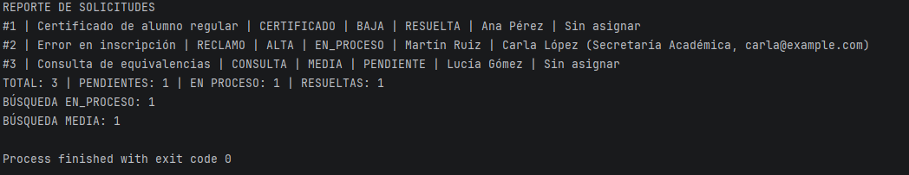
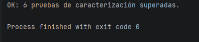

# Evidencia de ejecución inicial

**Versión:** `estado-inicial`  
**Fecha:** 21/10/2026  
**IDE:** IntelliJ IDEA 2025.3.4  
**JDK:** Eclipse Adoptium 21.0.10  
**Sistema operativo:** Windows

## 1. Ejecución de la aplicación

Se ejecutó la clase `Main` y se verificó el funcionamiento del sistema de solicitudes académicas.

Resultados obtenidos:

- Total de solicitudes: 3.
- Solicitudes pendientes: 1.
- Solicitudes en proceso: 1.
- Solicitudes resueltas: 1.
- Búsqueda por estado `EN_PROCESO`: 1 resultado.
- Búsqueda por prioridad `MEDIA`: 1 resultado.

La aplicación finalizó correctamente con `exit code 0`.

**Evidencia:**

## 2. Pruebas de caracterización

Se ejecutó la clase `PruebasCaracterizacion` para verificar el comportamiento inicial del sistema.

Resultado obtenido:

    OK: 6 pruebas de caracterización superadas.
    Process finished with exit code 0

**Evidencia:**

## 3. Objetivo de las pruebas

Los resultados registrados permiten establecer una referencia del comportamiento externo del sistema antes de aplicar refactorings.

Una vez realizadas las mejoras, se volverán a ejecutar las mismas pruebas para verificar que las funcionalidades existentes continúan funcionando correctamente.

## 4. Control de versiones

La versión inicial del sistema se identifica mediante el tag de Git `estado-inicial`.

Este tag permite conservar y consultar el código original para compararlo con la versión refactorizada.
